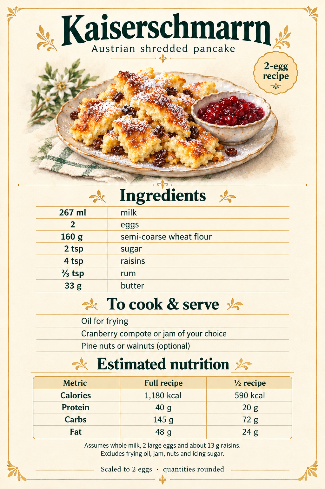

# Kaiserschmarrn

Austrian shredded pancake. Recipe scaled to 2 eggs; quantities rounded.

## Ingredients

- 267 ml milk
- 2 eggs
- 160 g semi-coarse wheat flour
- 2 tsp sugar
- 4 tsp raisins
- ⅔ tsp rum
- 33 g butter

## To cook and serve

- Oil for frying
- Cranberry compote or jam of your choice
- Pine nuts or walnuts (optional)

## Instructions

The supplied image does not include cooking instructions.

## Estimated nutrition, as printed on the supplied card

| Metric | Full recipe | Half recipe |
| --- | --- | --- |
| Calories | 1,180 kcal | 590 kcal |
| Protein | 40 g | 20 g |
| Carbs | 145 g | 72 g |
| Fat | 48 g | 24 g |

Assumes whole milk, 2 large eggs, and about 13 g raisins. Excludes frying oil, jam, nuts, and icing sugar. Values retain the supplied card's rounding.
