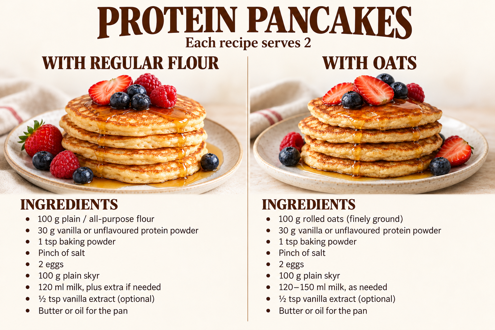

# Protein pancakes

Two alternative recipes. **Each recipe serves 2.** Choose one ingredient list.

## With regular flour · serves 2

- 100 g plain / all-purpose flour
- 30 g vanilla or unflavoured protein powder
- 1 tsp baking powder
- Pinch of salt
- 2 eggs
- 100 g plain skyr
- 120 ml milk, plus extra if needed
- ½ tsp vanilla extract (optional)
- Butter or oil for the pan

## With oats · serves 2

- 100 g rolled oats (finely ground)
- 30 g vanilla or unflavoured protein powder
- 1 tsp baking powder
- Pinch of salt
- 2 eggs
- 100 g plain skyr
- 120–150 ml milk, as needed
- ½ tsp vanilla extract (optional)
- Butter or oil for the pan

## Instructions

The supplied image does not include cooking instructions.

## Nutrition notes

The supplied image does not include nutrition values. The app calculates separate estimates for each variant using the assumptions below.

- Each variant makes 2 servings; the nutrition selector switches between regular flour and oats.
- Both estimates use 2 large eggs = 100 g, 1 tsp baking powder = 4 g, and 120 ml whole milk ≈ 124 g. Extra milk, optional vanilla, pan butter or oil, and toppings are excluded.
- Protein powder is estimated using the existing USDA soy protein isolate profile; actual vanilla or unflavoured powders vary by brand.
- Plain skyr uses the Arla Skyr Natural label (61 kcal, 10 g protein, 4 g carbohydrate, and 0.2 g fat per 100 g).

Skyr source: [Arla Skyr Natural label](https://www.arlafoods.co.uk/brands/arla-skyr/natural-450g/). Other profiles: [USDA FoodData Central](https://fdc.nal.usda.gov/download-datasets/).
